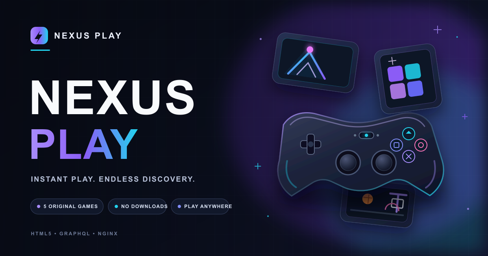

# Nexus Play



A CrazyGames-style HTML5 game portal built with Next.js App Router, React, TypeScript, Tailwind CSS, GraphQL Yoga, Prisma, and native MySQL 8. Express and Socket.IO provide realtime presence, Redis and BullMQ provide shared rate limits and background jobs, and Vite builds the PixiJS and Three.js game cartridges. No Docker is required or used.

## Included

- Responsive public portal with featured carousels, category browsing, search, favorites, recently played games, ratings, comments, and game detail pages.
- Seven original playable games with keyboard and touch controls, including PixiJS Web Worker simulation and a Three.js 3D racer.
- Lazy-loaded sandboxed game player with theater mode, fullscreen, restart, sharing, and score messages.
- JWT sessions in an HTTP-only cookie with PLAYER and ADMIN roles.
- Guest favorites and play history that synchronize after sign-in.
- Protected admin analytics, game library, four-step add/edit wizard, and category/tag management.
- Admin-only ZIP build and media upload endpoints with bounded parsing, rate limits, safe extraction, and atomic build publishing.
- COOP/COEP headers for uploaded games.

## Requirements

- Node.js 20.19 or newer, or Node.js 22.12 or newer.
- MySQL 8.0 or newer. The included local setup assumes the Windows installer location `C:\Program Files\MySQL\MySQL Server 8.0`.
- npm.
- Optional Redis 7 for shared rate limits, Socket.IO scale-out, and BullMQ jobs. Without Redis, rate limits and the play-count worker use bounded local fallbacks.
- Optional native OpenTelemetry Collector, Prometheus, Grafana, Sentry, and k6 binaries for monitoring and test execution.

## Local setup

### 1. Install dependencies

```bash
npm install
```

### 2. Start an isolated MySQL instance

The project uses port `3307` and a data directory inside `.runtime/mysql/data`, leaving an existing MySQL Windows service untouched. Adjust the installation and project paths below if this checkout is moved.

Create the data directory and initialize it once:

```powershell
New-Item -ItemType Directory -Force .runtime/mysql/data | Out-Null
& "C:\Program Files\MySQL\MySQL Server 8.0\bin\mysqld.exe" --initialize-insecure --datadir="F:\Ibrahim\web-games\.runtime\mysql\data" --basedir="C:\Program Files\MySQL\MySQL Server 8.0"
```

Start MySQL in a separate terminal and leave it running:

```powershell
& "C:\Program Files\MySQL\MySQL Server 8.0\bin\mysqld.exe" --datadir="F:\Ibrahim\web-games\.runtime\mysql\data" --basedir="C:\Program Files\MySQL\MySQL Server 8.0" --port=3307 --bind-address=127.0.0.1 --skip-name-resolve --log-error="F:\Ibrahim\web-games\.runtime\mysql\mysql-error.log" --pid-file="F:\Ibrahim\web-games\.runtime\mysql\mysql.pid"
```

If `.runtime/mysql/data` is already initialized and the server is running, skip this step.

### 3. Configure the database and environment

```bash
npm run db:setup
npm run db:migrate
npm run db:seed
```

`db:setup` creates `gameportal` and `gameportal_shadow`, grants a local application user access, and writes `.env` with generated database credentials and a random JWT secret. It does not print secrets. Running it again rotates the application password and JWT secret.

For an existing externally managed MySQL instance, copy `.env.example` to `.env` and provide valid `DATABASE_URL`, `SHADOW_DATABASE_URL`, and `JWT_SECRET` values instead.

### 4. Run the portal

```bash
npm run dev
```

Open `http://localhost:3000`. For live presence, start the realtime sidecar in a second terminal:

```bash
npm run dev:realtime
```

It listens on `127.0.0.1:3001` by default. Set `NEXT_PUBLIC_REALTIME_URL` when the browser cannot reach that address directly.

## Demo accounts

The seed creates these local demo accounts:

- Administrator: `admin@gameportal.local` / `Admin@12345`
- Player: `player@gameportal.local` / `Player@12345`

Change the administrator password before exposing the portal publicly.

## Scripts

| Command | Purpose |
| --- | --- |
| `npm run dev` | Start the development server. |
| `npm run build` | Create an optimized production build. |
| `npm run start` | Serve the production build. |
| `npm run dev:realtime` | Start the Express/Socket.IO presence service. |
| `npm run games:build` | Build the Vite PixiJS and Three.js cartridges. |
| `npm run worker:play-counts` | Run BullMQ jobs when Redis is configured, otherwise the local polling fallback. |
| `npm run start:pm2` | Start the web, realtime, and worker processes under PM2. |
| `npm run k6:smoke` | Run the small k6 HTTP/GraphQL smoke scenario. |
| `npm run k6:load` | Run the configurable k6 player scenario; capacity testing remains opt-in. |
| `npm run lint` | Run ESLint. |
| `npm run typecheck` | Run strict TypeScript checks. |
| `npm run db:setup` | Configure local databases and generate `.env`. |
| `npm run db:migrate` | Apply Prisma migrations. |
| `npm run db:seed` | Seed categories, tags, games, comments, and demo users. |
| `npm run db:generate` | Regenerate the Prisma client. |

## Upload API

Both endpoints require an authenticated administrator.

### Game build

`POST /api/upload/game-build` accepts `multipart/form-data` with:

- `slug`: lowercase letters, numbers, and single hyphens.
- `bundle`: a ZIP file, up to 250 MB.

A successful upload returns:

```json
{ "embedUrl": "/uploads/games/<slug>/index.html" }
```

The ZIP must contain `index.html` at its root. Extraction rejects traversal paths, backslashes, drive paths, symlinks, unsupported entry types, executable/script extensions, encrypted archives, excessive entry counts, uncompressed sizes above 750 MB, and suspicious compression ratios. Builds are extracted to a temporary directory and atomically published with rollback protection.

### Media

`POST /api/upload/media` accepts one `file` field. Supported formats are JPEG, PNG, WebP, MP4, and WebM. Images are limited to 10 MB and videos to 100 MB. The response contains a local `/uploads/media/...` URL.

Uploaded files are stored under `public/uploads`. Multi-instance or serverless deployments need shared persistent storage and a cross-process publishing lock; the current local implementation serializes publishes per slug within one Node process.

## SEO

- Public pages generate dynamic titles, descriptions, keywords, canonical URLs, Open Graph cards, and Twitter cards from the catalog.
- Game, category, tag, collection, and breadcrumb structured data is emitted as JSON-LD.
- `/sitemap.xml` includes published games and non-empty categories/tags; `/robots.txt` exposes the sitemap and blocks private or utility routes.
- Search, sign-in, personalized library, admin, API, and raw uploaded-game URLs are excluded from indexing.
- Set `NEXT_PUBLIC_APP_URL` to the final public HTTPS origin before deployment. Canonicals, sitemap URLs, structured data, and social images use this value.

## Production notes

- Serve the app over HTTPS so secure session cookies are enabled.
- Replace the seeded administrator password and keep `.env` private.
- Use a managed MySQL database and persistent upload storage for production.
- Configure a trusted reverse proxy before relying on forwarded client IP headers for rate limiting.
- Keep the `portal_session` cookie HTTP-only and do not expose the JWT secret to client code.
- Build with `npm run build`, then run `npm run start:pm2`. The ecosystem starts Next.js, the realtime sidecar, and the play-count worker without Docker.
- Configure `REDIS_URL` before relying on multi-process presence, distributed rate limits, or BullMQ. `DATABASE_POOL_SIZE` applies per Node process, so size the total pool against the MySQL connection limit.
- Native monitoring configuration lives in `deploy/monitoring`. Point `OTEL_EXPORTER_OTLP_ENDPOINT` at the collector and optionally configure `NEXT_PUBLIC_SENTRY_DSN`.
- The Nginx profile proxies `/socket.io/` to port 3001 with WebSocket upgrade headers. Validate it with the included Nginx binary using `scripts/start-nginx.ps1`.
- k6 scenarios are provided but were not executed as part of this stack integration. Set `K6_BASE_URL`, `K6_GAME_ID`, and `K6_TARGET_VUS` before an explicitly authorized run.
